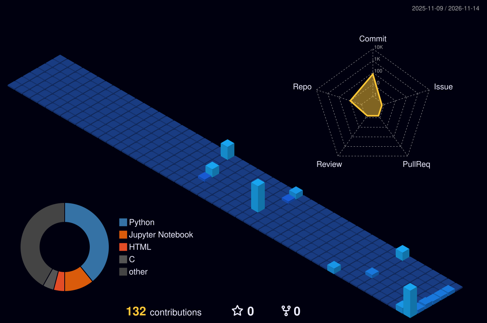

## Hi there 👋

<!-- Banner -->

<!-- Typing line -->

  

  

---

### 👋 About me

I'm Affaan, and I'm curious by default. If something looks complicated, I usually want to take it apart and see how it works.

Data is where I spend most of my time, but I'm not precious about labels. If there's an interesting problem, I'm in.

---

### 🛠️ Tools I use

  
  
  
  
  
  
  
  
  

---

### 📊 GitHub stats

  

  

<!-- 3D contribution graph (made by the workflow) -->

  

---

### 🐍 Contribution snake

  <picture>
    <source media="(prefers-color-scheme: dark)" srcset="snake/github-snake-dark.svg"/>
    
  </picture>

---

  

<!-- Footer wave -->

