<!-- Banner -->

<!-- Typing line -->

  

  

---

### 👋 About me

I've always been the person who asks "but why does it do that?" one time too many. For a long time that curiosity didn't really have anywhere to go.

Data gave it somewhere. Behind almost every question I care about there's a dataset that already knows part of the answer. The fun is in getting it to talk: cleaning it, poking at it, and modelling it until the pattern finally shows up.

I'm not tied to one tool or one corner of the field. I go wherever the question takes me, whether that's a quick chart, a model, or rebuilding the pipeline the data came from.

---

### 🛠️ Tools I use

  
  
  
  
  
  
  
  
  

---

### 📊 GitHub stats

    

<!-- 3D contribution graph (made by the workflow) -->

  

---

### 👻 Contribution Pac-Man

  

---

  

